# MediCare – Clinic Appointment Booking App

A modern, responsive clinic appointment booking application built with **Flutter and Dart**, integrated with a **FastAPI backend**.

MediCare provides three role-based workspaces for patients, doctors, and administrators, offering a unified platform for managing medical appointments, doctor availability, patient information, and clinic operations.

## Project Overview

MediCare is designed to simplify clinic appointment management through a consistent and responsive user experience across mobile, tablet, and desktop devices.

### Main Features

**Patient Panel**
- Patient registration and authentication.
- Browse and search doctors.
- Filter doctors by medical specialty.
- View doctor profiles and availability.
- Book, cancel, and reschedule appointments.
- Manage personal information.
- View appointment history and statuses.

**Doctor Panel**
- Doctor authentication and profile management.
- Upload and update doctor profile pictures.
- Manage professional information.
- Create and manage availability slots.
- View and manage appointments.
- Confirm, reject, and complete appointments.
- View dashboard statistics.

**Administrator Panel**
- Administrative dashboard and statistics.
- Manage users and account statuses.
- Browse doctors and patients.
- Manage medical specialties.
- View and manage appointments.

**Application Features**
- JWT-based authentication.
- Persistent login sessions.
- Role-specific navigation and workspaces.
- Centralized refresh functionality.
- Consistent application theme and design.
- Responsive mobile, tablet, and desktop layouts.
- Backend integration through REST APIs.

---

# Screenshots

## 1. Login and Authentication

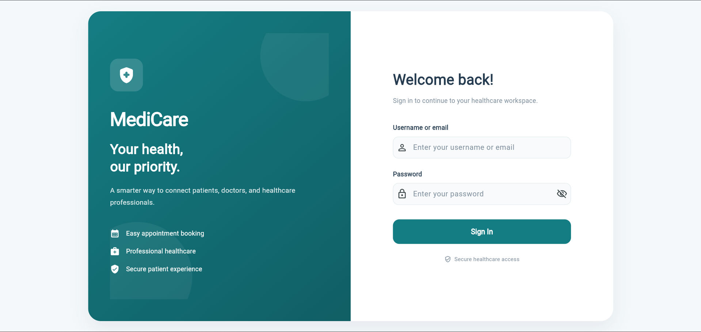

## 2. Patient Panel

### Patient Dashboard

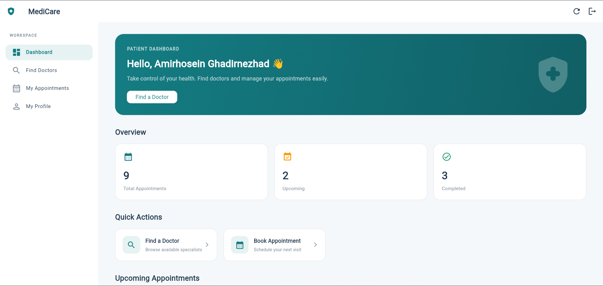

### Find Doctors

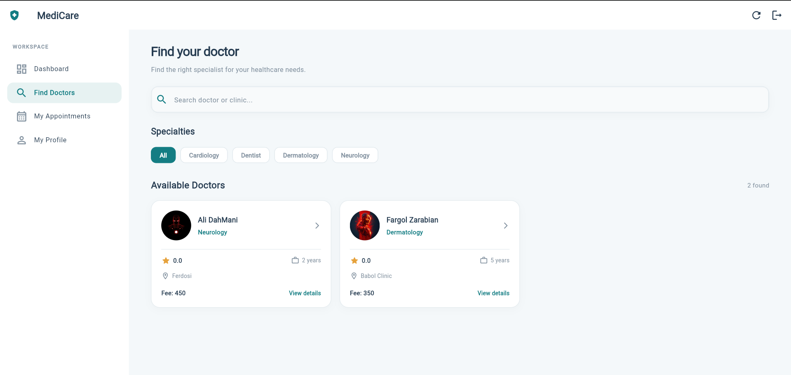

### My Appointments

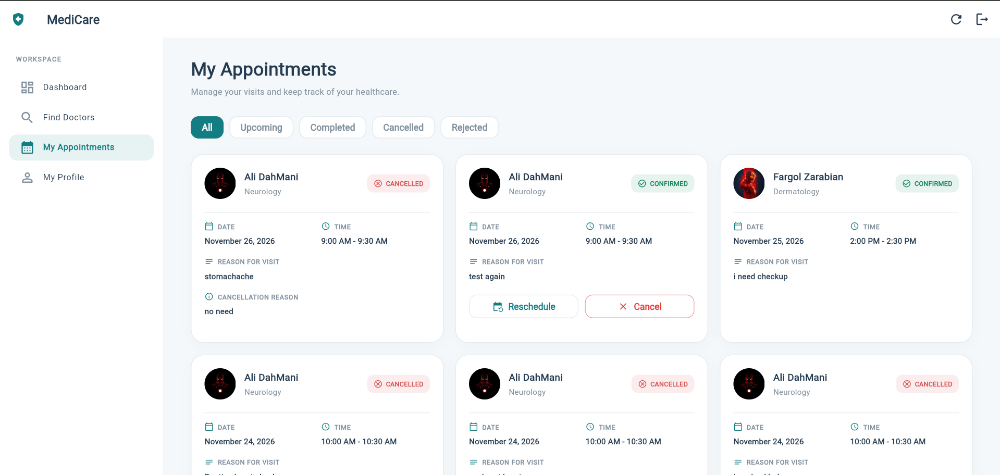

## 3. Doctor Panel

### Doctor Dashboard

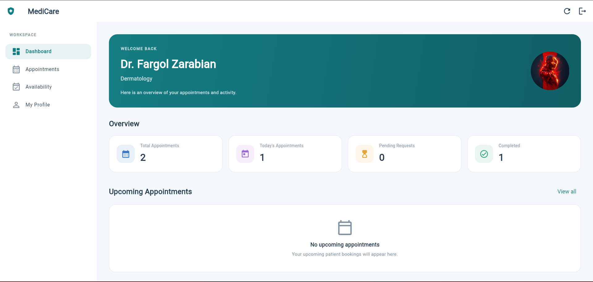

### Appointment Management

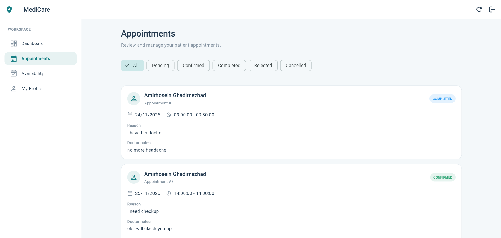

### Availability Management

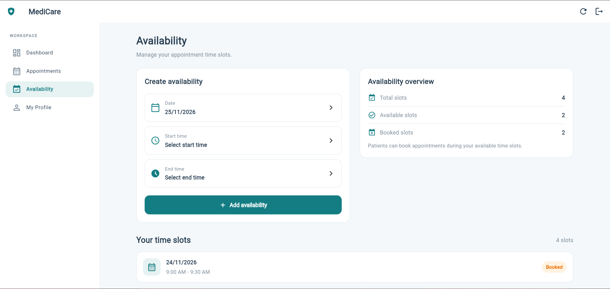

### Doctor Profile

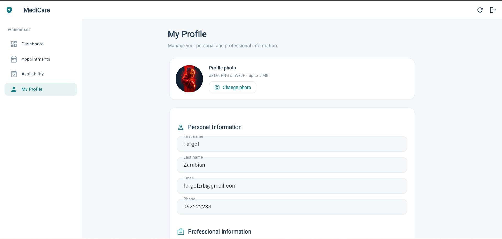

## 4. Administrator Panel

### Admin Dashboard

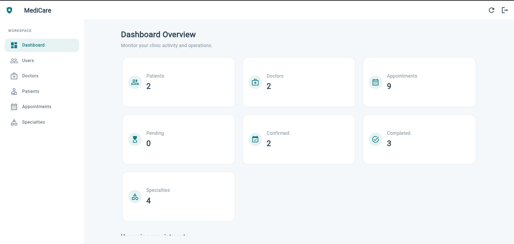

### User Management

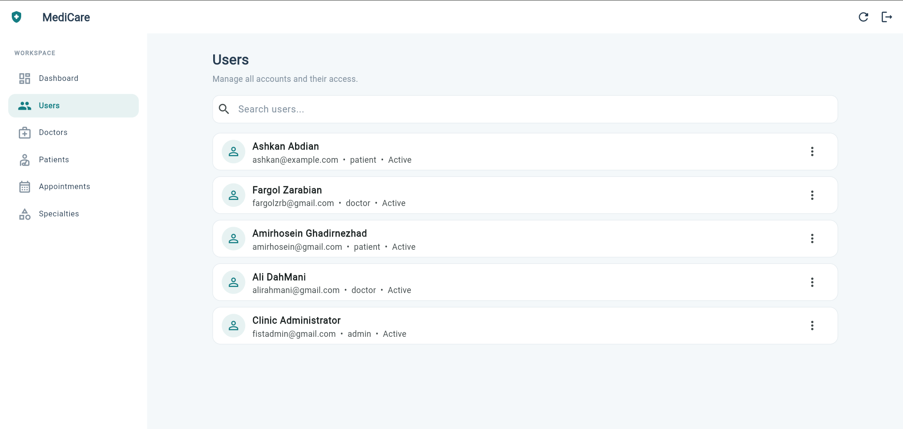

### Appointment Management

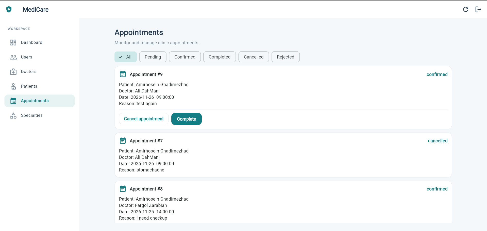

## 5. Responsive Mobile Design

### Patient Mobile Interface

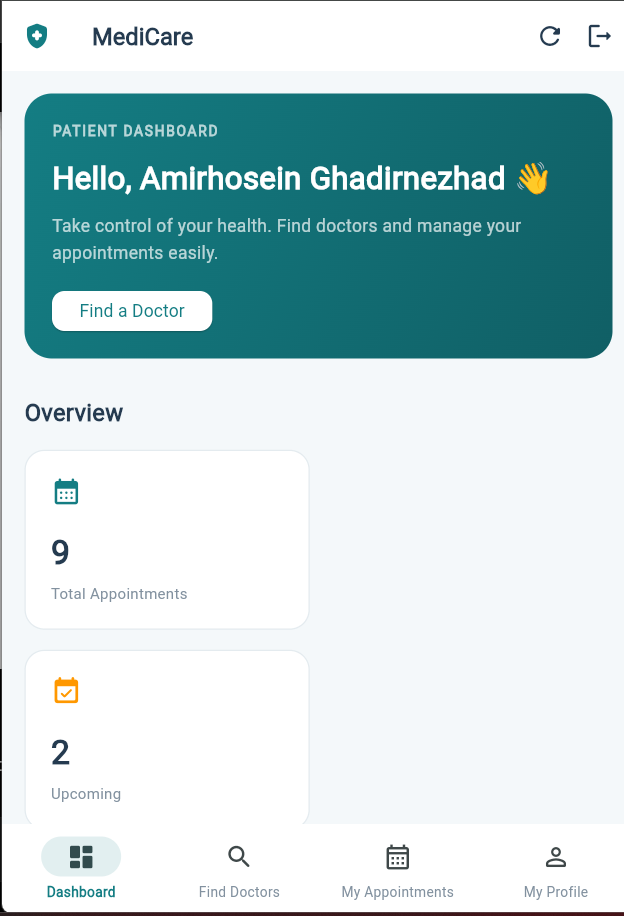

### Doctor Mobile Interface

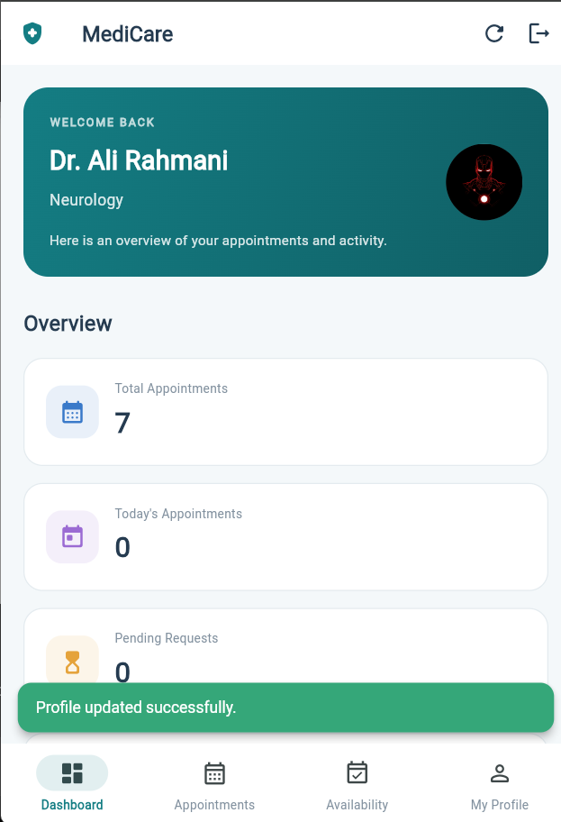

### Admin Mobile Interface

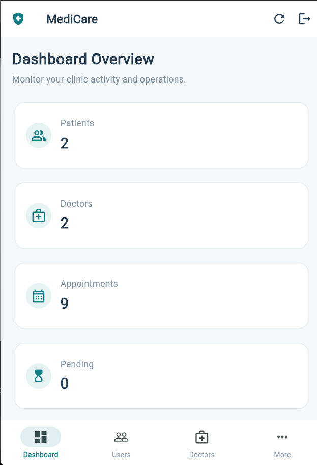

---

# Technology Stack

| Technology | Purpose |
|---|---|
| Flutter | Cross-platform UI framework |
| Dart | Application programming language |
| Material Design | User interface components |
| Dio | HTTP client and API communication |
| GoRouter | Application navigation |
| Flutter Secure Storage | Secure token storage |
| Image Picker | Doctor profile image selection |
| REST API | Backend communication |

# Project Architecture

The application follows a feature-oriented structure to organize screens, services, shared components, and application themes.

```text
lib/
├── core/
│   ├── constants/
│   └── services/
│
├── features/
│   ├── admins/
│   │   ├── data/
│   │   └── presentation/
│   │
│   ├── appointments/
│   │   ├── data/
│   │   └── presentation/
│   │
│   ├── authentication/
│   │   ├── data/
│   │   └── presentation/
│   │
│   ├── doctors/
│   │   ├── data/
│   │   └── presentation/
│   │
│   └── patients/
│       ├── data/
│       └── presentation/
│
├── shared/
│   └── widgets/
│
├── theme/
│
├── constants/
└── main.dart

assets/
screenshots/
test/
android/
ios/
web/
windows/
linux/
macos/
```

# Backend Integration

MediCare Flutter communicates with its FastAPI backend through REST API endpoints.

**Backend Repository:**

[ARK13-org/Clinic-Appointment-Booking-API](https://github.com/ARK13-org/Clinic-Appointment-Booking-API)

The application supports:
- Authentication and authorization.
- Patient and doctor profile management.
- Medical specialty retrieval.
- Doctor availability management.
- Appointment booking and management.
- Doctor profile image uploads.
- Role-specific dashboard data.

# Installation and Setup

## 1. Prerequisites

- Flutter SDK
- Dart SDK compatible with the project
- Android Studio or VS Code
- An available Android emulator, physical device, or Chrome browser
- A running MediCare FastAPI backend

## 2. Clone the Repository

```bash
git clone https://github.com/ARK13-org/Clinic-Appointment-Booking-Frontend.git

cd Clinic-Appointment-Booking-Frontend
```

## 3. Install Dependencies

```bash
flutter pub get
```

## 4. Configure the Backend URL

The API base URL can be supplied at build time using `API_BASE_URL`.

**Flutter Web:**

```bash
flutter run -d chrome --dart-define=API_BASE_URL=http://127.0.0.1:8000/api/v1
```

**Android Emulator:**

```bash
flutter run --dart-define=API_BASE_URL=http://10.0.2.2:8000/api/v1
```

For a physical device, use the backend computer's reachable LAN IP address instead of `127.0.0.1`.

Make sure the FastAPI server is running and accessible from the device.

## 5. Run Tests and Analysis

```bash
flutter analyze
flutter test
```

# Application Architecture and Design

MediCare uses a shared theme and reusable panel components to maintain a consistent design across all three user roles.

The responsive navigation adapts to different screen sizes:

- **Mobile:** Bottom navigation with access to additional sections.
- **Tablet:** Compact navigation rail.
- **Desktop:** Sidebar navigation with a structured workspace layout.

The application uses a centralized refresh action for the currently selected workspace section.

# Security

- Secure storage for authentication tokens.
- Server-validated session restoration.
- Role-based access enforced by the backend.
- Protected API communication.
- Doctor-only profile image upload.
- No private environment files or database records included in the repository.

For production, configure HTTPS and a trusted API host.

# Development Status

**Development and core integration completed.**

The application has been tested with its FastAPI backend, including patient, doctor, and administrator workflows, appointment management, availability scheduling, and doctor profile image uploads.

Flutter static analysis and automated tests pass in the development environment.

# Developer

**Alireza Koupaei**

GitHub Organization: [ARK13-org](https://github.com/ARK13-org)

**Repositories**

- [MediCare Flutter Frontend](https://github.com/ARK13-org/Clinic-Appointment-Booking-Frontend)
- [MediCare FastAPI Backend](https://github.com/ARK13-org/Clinic-Appointment-Booking-API)